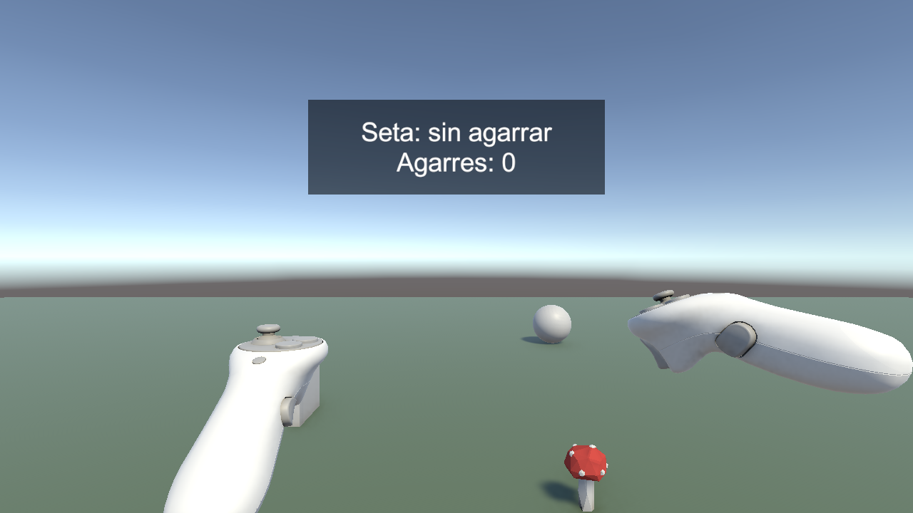
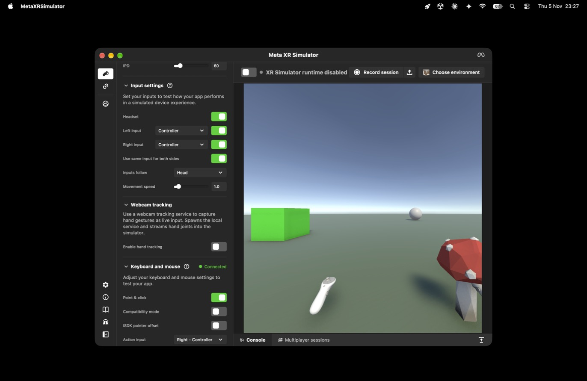
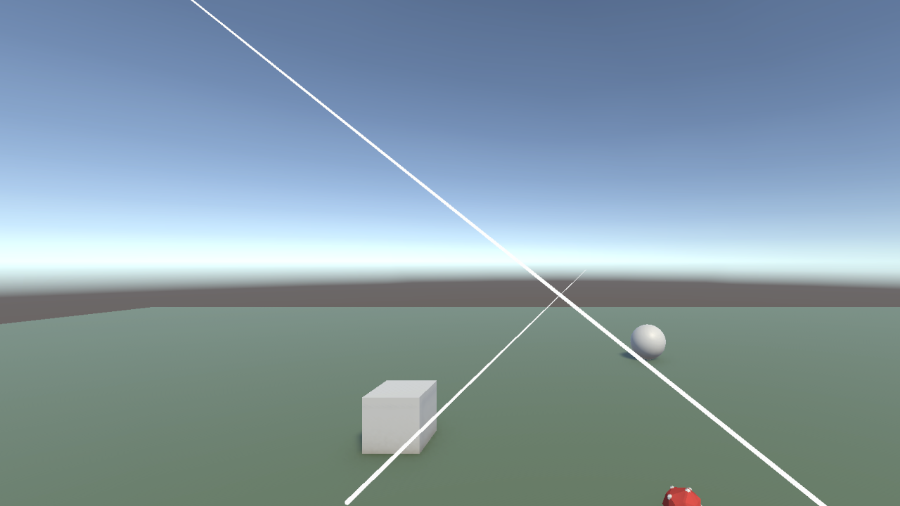

# Práctica: XR Interaction Toolkit

**Asignatura:** Interfaces Inteligentes  
**Fecha:** Noviembre 2026  
**Autor:** Ramón Izquierdo Izquierdo

---

## 1. Objetivo y contenido de la entrega

Escena de realidad virtual con un cubo, una esfera y un objeto de la Asset Store sobre un plano, cada uno a una distancia distinta. El cubo y la esfera cambian de color al seleccionarlos con un **Ray Interactor**. El objeto de la Asset Store actualiza la UI al agarrarlo con un **Direct Interactor**.

```
practica_XR/
├── README.md
├── capturas/                               Imágenes de la escena en funcionamiento
├── Packages/ y ProjectSettings/            Configuración del proyecto de Unity
└── Assets/
    ├── practica_XR/
    │   ├── Escenas/InteraccionXR.unity     Escena del ejercicio
    │   ├── Scripts/                        Lógica de la escena
    │   │   ├── CambioColorSeleccion.cs
    │   │   └── AgarreActualizaUI.cs
    │   ├── Editor/ConstructorXR.cs         Configura el proyecto y crea la escena
    │   └── Materiales/
    ├── Samples/XR Interaction Toolkit/     Starter Assets y XR Interaction Simulator
    ├── XR/ y XRI/                          Ajustes de OpenXR y capas de interacción
    └── Settings/                           Ajustes de URP
```

El *Low-Poly Simple Nature Pack* de la Asset Store no se incluye en el repositorio: hay que importarlo para abrir la escena (apartado 6).

---

## 2. Ejercicio

| Objeto | Distancia | Interactor | Al seleccionarlo |
|---|---|---|---|
| Seta (*Mushroom_01*, Asset Store) | 2,50 m | Direct | Se agarra y la UI muestra su estado y el número de agarres |
| Cubo | 4,09 m | Ray | Cambia de color |
| Esfera | 7,16 m | Ray | Cambia de color |

* **Cubo y esfera:** cada selección pasa al siguiente color (rojo, verde, azul, amarillo) y lo conserva al soltar.
* **Seta:** la UI pasa de `Seta: sin agarrar` a `Seta: agarrada` y suma un agarre. Al soltarla, cae sobre el plano.
* **Separación de interactores:** el rayo no puede agarrar la seta y la mano no puede seleccionar el cubo ni la esfera.
* **Movimiento:** el stick izquierdo mueve al jugador, porque la seta queda fuera del alcance de la mano al empezar.



---

## 3. Scripts

| Script | Función | Parámetros |
|---|---|---|
| `CambioColorSeleccion` | Se suscribe a `selectEntered` del interactuable y cambia el color con un `MaterialPropertyBlock`, sin alterar el material compartido | `colores` |
| `AgarreActualizaUI` | Se suscribe a `selectEntered` y `selectExited` del `XR Grab Interactable` y escribe el estado en el texto | `textoEstado`, `nombreObjeto` |
| `ConstructorXR` | Menú *Práctica XR* del editor: importar samples, configurar OpenXR, crear la escena y elegir simulador | |

---

## 4. Escena e interacción

* **XR Origin (XR Rig):** procede de Starter Assets y sustituye a la Main Camera, que se elimina porque el rig trae su propia cámara.
* **Interactores:** el prefab usa un `Near-Far Interactor`, que reúne rayo y agarre. Como el ejercicio pide uno de cada tipo, se desactiva y cada mando recibe un `XR Ray Interactor` y un `XR Direct Interactor`, conectados a las mismas acciones de entrada. También se desactivan los interactores de teletransporte y de pulsación, que no se usan.
* **Capas de interacción:** `Rayo` para el Ray Interactor, el cubo y la esfera; `Directo` para el Direct Interactor y la seta.
* **Prioridad:** dentro del grupo de cada mando, el Direct va antes que el Ray. Si la mano toca la seta, el grip la agarra.
* **Cubo y esfera:** `XR Simple Interactable` y el `Collider` de la primitiva. No llevan `Rigidbody` ni `XR Grab Interactable` porque no se agarran; así no salen disparados hacia el mando al seleccionarlos.
* **Seta:** `BoxCollider`, `Rigidbody` y `XR Grab Interactable`, los tres componentes que pide el guion, con `Use Dynamic Attach` para agarrarla por donde la toca la mano.
* **UI:** `Canvas` en el espacio del mundo. Solo muestra información, así que el rayo no interactúa con ella.
* **Línea del rayo:** tal como viene, el prefab no la dibujaba en esta escena. Se le ha puesto un material de partículas de URP, la longitud real del rayo (15 m) y colores sin desvanecer.

---

## 5. Simuladores

### Simulador genérico del XR Interaction Toolkit (por defecto)

Es la alternativa que da el guion si el simulador de Meta da problemas. Está en la escena con la etiqueta `EditorOnly`, de modo que no se incluye al compilar para las gafas.

| Acción | Tecla |
|---|---|
| Moverse | `W` `A` `S` `D`, `Q` `E` para bajar y subir |
| Mirar o rotar | Botón derecho y ratón |
| Controlar el mando izquierdo o el derecho | `[` / `]` |
| Controlar la cabeza | `H` |
| Grip (seleccionar) | `G` |
| Trigger | `T` |

### Meta XR Simulator

**Funciona en este Mac (Apple Silicon)**, con la versión 207.1 de la aplicación independiente. Ya no es un paquete de Unity: se [descarga e instala aparte](https://developers.meta.com/horizon/downloads/package/meta-xr-simulator-mac-arm/). No hizo falta iniciar sesión, ni el *Meta XR Core SDK*, ni cambiar el runtime OpenXR del sistema.

1. Instalar `MetaXRSimulator.app` en `/Applications`.
2. Abrir el proyecto y ejecutar *Práctica XR > 4 - Usar Meta XR Simulator*. Fija `XR_RUNTIME_JSON` solo para ese proceso de Unity y desactiva el simulador genérico. Hay que repetirlo cada vez que se abre Unity.
3. Pulsar Play. La escena se abre en la ventana del simulador.
4. Para volver, ejecutar *Práctica XR > 5 - Usar simulador genérico*.

La etiqueta *XR Simulator runtime disabled* de la aplicación es normal con este método, porque se refiere al runtime del sistema.

| Acción | Tecla |
|---|---|
| Moverse | `W` `A` `S` `D`, `R` `F` para subir y bajar |
| Grip (seleccionar) | `U` |
| Trigger | `T` |
| Hacer que el rayo siga al cursor | Opción *Point & click* del panel *Keyboard and mouse* |



---

## 6. Configuración y reproducción

| Ajuste | Valor |
|---|---|
| Unity | 6000.6.4f1 con URP 17.6.0 |
| XR Interaction Toolkit | 3.7.0 |
| OpenXR Plugin | 1.19.0 |
| XR Plugin Management | 4.6.1 |
| Cargador XR | OpenXR en Standalone y Android |
| Perfiles de interacción | Oculus Touch, Meta Quest Touch Plus y Meta Quest Touch Pro |
| Android | IL2CPP, ARM64, API mínima 32, soporte de Meta Quest |
| Project Validation | Sin avisos en Standalone ni en Android |

Para abrir el proyecto:

1. Abrir la carpeta `practica_XR` con Unity 6000.6.4f1.
2. Importar el [*Low-Poly Simple Nature Pack*](https://assetstore.unity.com/packages/3d/environments/landscapes/low-poly-simple-nature-pack-162153).
3. Ejecutar *Práctica XR > 3 - Crear la escena*, que también convierte los materiales del paquete a URP.
4. Abrir `Assets/practica_XR/Escenas/InteraccionXR.unity` y pulsar Play.

Las opciones 1 y 2 del menú solo hacen falta si se parte de un proyecto vacío.

---

## 7. Recursos externos

* [Low-Poly Simple Nature Pack](https://assetstore.unity.com/packages/3d/environments/landscapes/low-poly-simple-nature-pack-162153), de JustCreate: la seta.
* XR Interaction Toolkit: samples *Starter Assets* y *XR Interaction Simulator*.
* [Meta XR Simulator](https://developers.meta.com/horizon/documentation/unity/xrsim-getting-started/) 207.1, instalado aparte.

---

## 8. Verificación y limitaciones

**Con la escena final, en el editor y en modo Play (35 de 35 comprobaciones correctas),** mediante un verificador temporal que no forma parte de la entrega. Usa los interactores reales y mandos simulados que pasan por las mismas acciones de entrada:

* El simulador genérico crea la cabeza y los dos mandos; con eventos de teclado, `]`, `G` y `W` eligen el mando, aprietan el grip y lo mueven.
* El rayo derecho selecciona el cubo (rojo y luego verde) y el izquierdo la esfera. Apuntar sin pulsar no selecciona, y el cubo no se mueve.
* El rayo no agarra la seta y la mano no selecciona el cubo.
* El Direct agarra la seta, la seta sigue a la mano, la UI se actualiza y, al soltarla, la seta cae sobre el plano.
* El stick izquierdo mueve al jugador, a 60 FPS.

**Con el Meta XR Simulator,** manejando su ventana con teclado y ratón y leyendo el estado desde el registro de Unity:

* Unity lo carga como runtime OpenXR y funciona a 72 FPS con la cabeza y los dos mandos *Quest Touch Plus*.
* El rayo derecho detecta el cubo y, con el grip, lo cambia a rojo y a verde.
* La mano detecta la seta y, con el grip, la agarra. La UI pasa a `Seta: agarrada` y vuelve a `Seta: sin agarrar` al soltarla.
* Las líneas de los rayos se dibujan en la imagen del ojo izquierdo.



Estas pruebas de interacción con Meta se hicieron antes de ajustar la línea del rayo. Después de ese cambio, solo visual, se comprobó con Meta la carga del runtime, los 72 FPS y el dibujo de las líneas, y con el genérico las 35 comprobaciones.

**Sin comprobar:**

* En unas gafas Quest reales. Tampoco se ha generado un APK, porque el guion no lo pide.
* A mano en la ventana de Unity con el simulador genérico: se usaron eventos de teclado simulados, no un teclado físico.
* Con el Meta XR Simulator: seleccionar la esfera, usar el mando izquierdo, levantar la seta agarrada y verla caer. Todo ello sí está comprobado con el genérico. La esfera no se llegó a seleccionar con *Point & click*, y no se ha determinado la causa exacta.
* El simulador de Meta en Windows, la plataforma que cita el guion.

**Avisos conocidos:**

* Con el simulador genérico no hay runtime OpenXR en Mac, así que Unity registra en `Editor.log` errores de `OpenXR-Loader` al pulsar Play. No impidieron completar las 35 comprobaciones.
* En *Point & click*, el clic izquierdo no selecciona: la acción Select del toolkit va asociada al grip, que es la tecla `U`.
